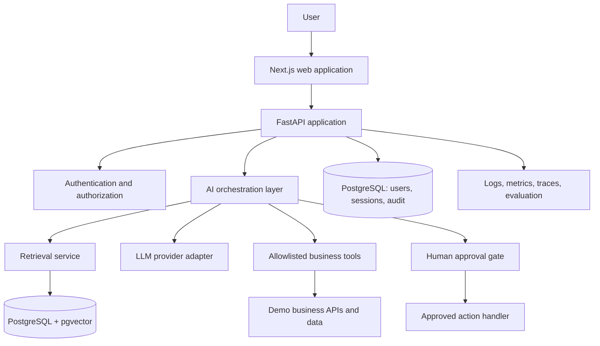

# Nexus AI — Enterprise Intelligence & Automation Platform

> **Status: Day 1 scaffold committed; GitHub CI passing; local Docker verification pending.**

[](https://github.com/mrchandrabhan/Nexus-AI/actions/workflows/ci.yml)

Nexus AI is a portfolio project exploring how an enterprise AI assistant can move beyond chat and safely help people work with organizational knowledge and business systems. The intended MVP combines retrieval-augmented generation (RAG), citations, controlled tool calling, and human-approved actions.

**Repository:** https://github.com/mrchandrabhan/Nexus-AI  
**Portfolio:** https://mrchandrabhan.github.io/

## Project goals

- Answer questions over uploaded knowledge-base documents with source references.
- Integrate selected read-only business tools (for example, querying a demo support or operations dataset).
- Keep user identity, permissions, and conversation history explicit.
- Require confirmation before state-changing actions.
- Make AI behavior measurable through an evaluation set and request-level telemetry.

## Current status

This repository currently contains the initial project definition, architecture, and roadmap. The application features below are **planned**, not yet represented as completed functionality.

| Capability | Status |
|---|---|
| Repository baseline and architecture | Published |
| Next.js application shell | Planned |
| FastAPI service and health endpoint | Planned |
| PostgreSQL schema and migrations | Planned |
| Document ingestion and pgvector retrieval | Planned |
| Grounded answers with citations | Planned |
| Tool calling against demo APIs | Planned |
| Authentication, tenant isolation, and RBAC | Planned |
| Human approval for write actions | Planned |
| Evaluation, tests, and observability | Planned |
| Containerized deployment and CI | Planned |

## Proposed architecture



See [docs/architecture.md](docs/architecture.md) for design decisions and trust boundaries.

## Planned technology

| Area | Initial choice | Purpose |
|---|---|---|
| Web | Next.js, TypeScript | Chat and administration UI |
| API | Python, FastAPI | Typed application API |
| Data | PostgreSQL | Users, conversations, metadata |
| Retrieval | pgvector | Embedding storage and similarity search |
| AI orchestration | Provider adapter; LangGraph if workflow complexity warrants it | Tool routing and controlled multi-step flows |
| Tests | pytest and frontend tests | Unit and integration coverage |
| Local environment | Docker Compose | Reproducible development |
| Delivery | GitHub Actions | Lint, test, and build automation |
| Observability | OpenTelemetry-compatible instrumentation | Request traces and latency/error visibility |

Provider credentials are supplied locally through environment variables. No secrets should be committed.

## MVP scope

1. Create an authenticated chat workspace.
2. Upload PDF and Markdown documents.
3. Parse, chunk, embed, and index documents.
4. Retrieve relevant passages and show citations in responses.
5. Add one read-only tool over clearly defined demo data.
6. Add one proposed state-changing workflow that cannot run without explicit approval.
7. Record test results for retrieval quality, citation validity, latency, and failure paths.

Out of scope for the first MVP: autonomous access to production systems, unrestricted SQL execution, multi-tenant enterprise SSO, and unsupervised write actions.

## Security and reliability principles

- Treat uploaded documents and retrieved content as untrusted input.
- Enforce authorization in the API and tool layer, not only in prompts.
- Use allowlisted tools with validated schemas and least-privilege credentials.
- Keep read operations separate from write operations.
- Require an explicit human approval step before write actions.
- Avoid logging secrets or unnecessary sensitive document contents.
- Add timeouts, request limits, input validation, and clear failure responses.
- Evaluate groundedness and citation correctness; do not assume fluent output is correct.

## Development roadmap

See [docs/roadmap.md](docs/roadmap.md). Work is tracked in GitHub Issues. The roadmap is incremental: a working, testable vertical slice comes before advanced agents or infrastructure.

## Day 1 scaffold — run locally

### Prerequisites
- Docker Desktop with the Linux container engine running.
- Git.

### Start the complete stack

From the repository root:

```powershell
docker compose up --build
```

Open:
- Web application: http://localhost:3000
- API documentation: http://localhost:8000/docs
- API liveness: http://localhost:8000/health
- API/database readiness: http://localhost:8000/ready

PostgreSQL is exposed on host port `5433`. The `pgvector` extension is enabled by the initialization script. The current UI is a service-status and workspace shell; document upload, RAG, chat, and tools are not implemented yet.

### Run backend tests

```powershell
docker compose exec backend pytest -q
```

### Stop the stack

```powershell
docker compose down
```

To remove the local database volume as well (destructive): `docker compose down -v`.

### Useful commands

```powershell
docker compose ps
docker compose logs -f backend
docker compose logs -f frontend
docker compose logs -f db
```

The Compose file uses disposable development credentials for a local portfolio environment. Do not reuse them outside local development. Never commit real secrets.

## Portfolio context

This project complements [Agentic RAG Document Q&A](https://github.com/mrchandrabhan/agentic-rag-docqa). The earlier project focuses on document question answering and retrieval evaluation; Nexus AI is intended to explore enterprise application integration, authorization boundaries, and human-approved workflows.

## License

No license has been selected yet. Until one is added, normal copyright restrictions apply; please do not assume the code is reusable under an open-source license.
